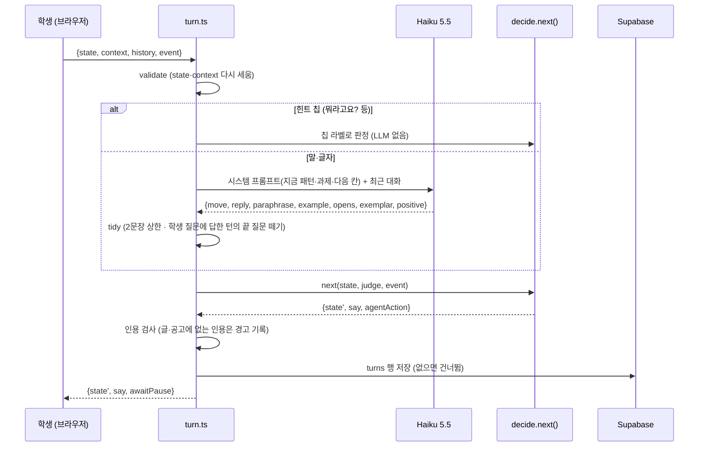

# 서강 글벗 v3 — 아키텍처

갱신 2026-11-03 · 대상 커밋: `main` · 설계 근거: `제안 - v3 새로 짜기 (ponytail).md` · `제안 - NCF 패턴으로 대화 설계.md` · `대본 목업 - NCF 패턴 1차.md`

---

## 1. 한눈에

서강 글벗은 대학생의 자기소개서를 **말로 대화하며** 함께 고치는 연구용 튜터다 (서강대학교 CAAI 연구실).
20분 세션: **첫 진단 → 과제 3개를 차례로 → 마무리 요약**. 학생은 튜터와 말로 이야기하고, 문단은 자기 손으로 고친다.

설계 원칙 세 가지:

1. **판단은 모델이 한 번에, 결정은 코드 한 곳에서.** 한 턴에 LLM은 1회(Haiku)만 부르고, 그 판정으로 상태를 옮기는 일은 순수 함수 `next()` 하나가 한다.
2. **대화는 NCF 패턴.** 상태를 옮기는 것은 기본 짝의 둘째 짝(학생의 답)뿐이고, 되묻기·확인·인정은 상태를 바꾸지 않는다 (Moore & Arar 2019).
3. **완료는 글이 실제로 나아졌을 때.** 학생이 대상 문단을 고치고, 재평가가 "원래보다 낫다"고 하면(또는 시범 문장을 받아들이면) 과제가 끝난다.

```
┌──────────────────────── 브라우저 (React + Vite) ────────────────────────┐
│ Landing ─▶ Session ─────────────────────────────────▶ Summary           │
│            │  voice.ts (음성 인식·합성)                                   │
│            │  상태(SessionState)를 들고 매 턴 서버에 보낸다                 │
└────────────┼────────────────────────────────────────────────────────────┘
             │ POST /api/diagnose · /api/turn · /api/evaluate · /api/summary
┌────────────▼──────────── Netlify Functions (상태 없음) ─────────────────┐
│ validate → (LLM 1회) → next() → checks → db 저장 → {ok, data, error}   │
└────────────┬───────────────────────────────┬────────────────────────────┘
             │ Anthropic Messages API         │ Supabase (선택)
             ▼                                ▼
   Sonnet 5.5: 진단·요약              sessions · turns
   Haiku 5.5: 턴·재평가
```

## 2. 세션 흐름

| 단계 | 누가 | 무엇을 | LLM |
|---|---|---|---|
| 시작 | 학생 | 자기소개서(필수) · 지원 공고(선택) · 이력 메모(선택) · 언어 | — |
| 첫 진단 | `/api/diagnose` | 평가(주장별 근거 등급) + 과제 3개(각 완료 기준·첫 질문) + 브리핑 3파트 | Sonnet 1회 |
| 브리핑 | 코드 | 인사 → 브리핑 파트 1·2·3 (학생의 쉼이나 맞장구로 다음 파트) → 과제 1 시작 제안 | 0 |
| 과제 진행 | `/api/turn` | 학생 발화 판정 + 튜터의 다음 말 | Haiku 1회/턴 |
| 과제 수락 | 코드 | 진단이 만든 첫 질문(`opener`)을 바로 말함 | 0 |
| 문단 수정 | `/api/evaluate` | 고친 문단이 완료 기준을 원래보다 더 채우나 | Haiku 1회 (시범 문장 그대로면 0) |
| 마무리 | 코드 | 과제 표에서 만든 요약 파트 → 성공 확인 → 작별 | 0 |
| 요약 화면 | `/api/summary` | 튜터의 정리 + 다음에 할 것 | Sonnet 1회 |

## 3. 한 턴의 흐름 (`/api/turn`)



- **서버는 상태를 들고 있지 않다.** 클라이언트가 매 턴 `SessionState`를 보내고, 서버는 `parseState`로 모양을 다시 세운 뒤에만 쓴다 (모르는 필드는 버림).
- **모델이 만든 말 vs 코드가 만든 말.** 브리핑·과제 시작 질문·시간 제안·마무리·수리 응답(반복/바꿔 말하기/예시)은 코드가 말한다 (`lines.ts`, `state.last`). 모델은 그 밖의 대화 문장만 만든다.

## 4. 상태 모델 (`src/state.ts`)

```
SessionState
├─ stage      opening → briefing → content / form → closing → ended
├─ open       지금 열린 첫째 짝 = NCF의 previous_node
│             { pattern: A3 | A5.0 | A5.1 | A5.5 | A2.6 | P1 | P1.4 | C4 …, firstPair, parts?, effect?, taskId? }
├─ topic      지금 다루는 키워드·문단 ("그건 어디 넣어요?"의 '그건')
├─ last       { played, paraphrase, example } — 수리 요청에 LLM 없이 답할 재료
├─ repaired   수리·학생 질문 직후인가 (이때의 "고마워요"는 곁가지만 닫는다, B4.4)
├─ unclearStreak  못 알아들은 횟수 (1: 다시 말해 줄래요? · 2: 예시와 함께 · 3: 다른 과제 제안)
├─ tasks[3]   { kind: content|form, target, goal, doneWhen, opener, status, evidence, fromExemplar,
│               startedAt, endedAt, turns, edits, experience[], exemplar, nudged }
└─ startedAt · helped · closeOffered
```

과제 상태: `pending → active → done | skipped | timeout`. 시간 초과는 **제안**이고 강제가 아니다 (과제당 약 5분, 마감 3분 전 마무리 제안).

첫 진단의 **평가**(`Assessment`: 글 전체 평 + 주장별 `{paragraph, claim, evidence: strong|weak|none, note}`)는 화면만 들고 있다. 턴마다 오가는 상태에는 넣지 않는다.

## 5. 판정 라벨 (Haiku가 고른다, NCF 1차 13개)

| 라벨 | 뜻 | `next()`가 하는 일 |
|---|---|---|
| ANSWER · CONTINUER | 답 · 맞장구 | 열린 패턴의 다음 칸 · 브리핑 다음 파트 / 경험 이어 붙임 |
| ACCEPT · REJECT | 제안·결론 수락 · 거절·정정 | 과제 시작/결론 확인 · 다른 후보로 (재설득 없음) |
| EXEMPLAR_REQ | 써 달라 | 시범 한 문장 (대필 금지) |
| REPEAT_REQ · PARAPHRASE_REQ · EXAMPLE_REQ | 되묻기 | `last`에서 코드가 답 (상태 그대로) |
| USER_INQUIRY | 학생의 질문 | 답하고 원래 시퀀스 유지 |
| CLOSER | 인정·감사 | 시퀀스 닫기 (수리 직후면 곁가지만) |
| ABORT · PRE_CLOSING | 그만 · 끝내자 | 과제 skipped · 마무리(요약 먼저) |
| UNCLEAR | 못 알아들음 | 단계적 되묻기 |

판정 정확도(지어낸 대본 29발화, 다음 행동 기준): 약 90% — `experiments/` 참고.

## 6. 과제 완료 판정 (`/api/evaluate`)

```
학생이 대상 문단 저장 ─▶ 시범 문장을 그대로 넣었나? ── 예 ─▶ done (재평가 없음, fromExemplar)
                              │ 아니오
                              ▼
               Haiku: "고친 문단이 doneWhen을 원래보다 더 채우나?" → {better, reason}
                              ├ better  → done, 튜터가 reason으로 칭찬 한 문장
                              └ !better → active 유지, 튜터가 reason으로 힌트 한 문장
```

## 7. LLM 호출 (`src/llm.ts`)

| 호출 | 모델 | 생각 깊이(effort) | 시간 제한 | 출력 |
|---|---|---|---|---|
| 진단 | `claude-sonnet-5-5` | medium | 22초 | 평가 · 과제 3개 · 브리핑 |
| 턴 | `claude-haiku-5-5` | low | 12초 | 판정 + 튜터 말 |
| 재평가 | `claude-haiku-5-5` | low | 12초 | {better, reason} |
| 요약 | `claude-sonnet-5-5` | medium | 22초 | {report, nextSteps} |
| 튜터 목소리 | Google TTS `Chirp3-HD` (ko Autonoe · en Aoede) | — | 8초 | MP3 (`/api/tts`) |

- 모두 **구조화된 출력**(`output_config.format` json_schema)으로 받는다. Sonnet 5.5는 강제 `tool_choice`를 받지 않기 때문이다. 스키마는 보내기 전에 `additionalProperties:false`로 닫고 지원 안 되는 `minItems/maxItems`를 뺀다 — 개수 검사는 `validate.ts`가 응답 뒤에 한다.
- 5.5 모델은 생각 토큰도 `max_tokens`에 들어가므로 출력 상한에 여유(6000)를 더한다. `temperature`는 보내지 않는다.
- 공고가 비어 있으면 프롬프트에 "공고 없음"을 명시해 모델이 공고 요구를 지어내지 않게 한다 (`postingText`).
- 모델 출력은 신뢰 경계다: 형식이 틀리면 사용자에게 "다시 보내 주세요"로 보이고, 서버 로그에 원인이 남는다.

## 8. 화면 (`src/client/`)

| 파일 | 역할 |
|---|---|
| `App.tsx` | 화면 셋을 상태 하나로 고른다 (라우터 없음) |
| `Landing.tsx` | 글·공고(선택)·이력(선택)·언어 입력, 문단 나눔 미리보기 → 진단 |
| `Session.tsx` | 세션 화면 조립, 턴·재평가 호출, 쉼 이벤트 |
| `Masthead.tsx` · `TaskStrip.tsx` · `Stamp.tsx` | 제호 띠(CAAI 표기·남은 시간) · 과제 3꼭지 · 도장 |
| `EssayPanel.tsx` · `AutoTextarea.tsx` | 글 전체를 문서로, 지금 문단은 늘 편집 가능, 다른 문단은 눌러서 고침 |
| `DiagnosisNote.tsx` | 첫 진단 평가 (편집 메모) — 세션에선 브리핑 동안 펼침·과제 시작 후 접힘, 요약에서 다시 |
| `VoicePanel.tsx` · `MicDesk.tsx` | 튜터의 지금 말(큰 자막) · 학생 실시간 자막 · 마이크 상태 · 말하기 힌트 · 글자 입력 보조 |
| `voice.ts` | 음성 훅 — 학생: 브라우저 SpeechRecognition / 튜터: `/api/tts`(Google TTS)를 `<audio>`로 재생, 없으면 speechSynthesis. 메아리 제거 세 겹(반이중 인식 · 메아리 제거 마이크로 끼어들기 감지 · 끝난 직후 글자 겹침 거르기) |
| `Summary.tsx` | 과제 표 · 튜터의 정리 · 처음 진단 · 처음 글/끝 글 |
| `styles.css` | 디자인 토큰(라이트/다크) — 규칙은 `DESIGN.md` |

음성 상태: `listening · speaking · thinking · muted · unsupported`. 학생 말이 끝나고 1.2초 조용하면 한 턴으로 보낸다. 문단을 고치는 동안은 듣기를 멈춘다.

## 9. 저장 (`supabase/schema.sql`, 선택)

- `sessions` — 언어·공고·처음 글·끝 글·과제 표·요약·성공 확인.
- `turns` — 턴마다 학생 말·튜터 말·`user_action`(판정 라벨)·`agent_action`(코드 행위)·`apr`(시퀀스 안의 자리)·판정 전체·지연.
  NCF 지표(시퀀스 완료율·상호작용 효율·확장 종류 분포)를 이 행들로 나중에 계산한다.
- 서버만 service_role 키로 쓴다. RLS를 켜고 정책을 두지 않아 브라우저에서는 읽기·쓰기 모두 막힌다. 환경 변수가 없으면 저장만 건너뛴다.

## 10. 폴더

```
sogang-tutor-v3/
├─ netlify/functions/   diagnose · turn · evaluate · summary (입구, 각 50~80줄)
├─ src/
│  ├─ state.ts          타입 · 상수 (20분 · 과제 5분 · 마감 경고 3분)
│  ├─ decide.ts         next() — 결정의 유일한 자리 (순수 함수)
│  ├─ respond.ts        턴 LLM 호출 + 결정적 다듬기
│  ├─ llm.ts            Anthropic 호출 하나 (구조화된 출력)
│  ├─ prompt.ts         프롬프트 .md 읽기 · 채우기 · 턴 스키마
│  ├─ prompts/          tutor.ko/en · diagnose · evaluate · summary (.md)
│  ├─ lines.ts          코드가 말하는 문장 (ko/en)
│  ├─ checks.ts         문장 수 · 끝 질문 떼기 · 인용 검사 · 시간 · 상투 표현 사전
│  ├─ validate.ts       신뢰 경계 검사 (요청 본문 · 클라이언트 상태 · LLM 출력)
│  ├─ db.ts · http.ts   Supabase 저장 · 응답 봉투 {ok, data, error}
│  └─ client/           화면 (8절)
├─ tests/               decide 표 테스트(대본 목업) · checks · handlers · validate (node:test)
├─ experiments/         판정 정확도 · 판정+응답 · 골드 29발화 · 실제 API 연기 시험
├─ supabase/schema.sql
├─ PRODUCT.md · DESIGN.md · ARCHITECTURE.md
└─ 제안·대본 목업 문서 3개
```

## 11. 검증

```bash
npx tsc --noEmit                           # 타입
npm test                                   # 유닛 55개 (오프라인, LLM 0회)
npm run build                              # 프로덕션 빌드
npm run gold                               # 골드 29발화 실제 API (다음 행동 일치율)
npx tsx experiments/live_smoke.ts <.env>   # 네 함수를 실제 API로 한 번씩
npx netlify-cli dev                        # 로컬 http://localhost:8888
```

## 12. 알려진 한계 · 다음 단계

- **음성은 브라우저 내장 엔진.** Chrome 음성 인식은 구글 서버를 거친다. 연구실 lab-server로 바꿀 때 `src/client/voice.ts`만 교체한다.
- 메아리: 튜터가 말하는 동안은 인식을 끄고(반이중), 끼어들기는 Chrome 메아리 제거가 걸린 마이크 소리 크기로 잡는다. 끼어든 첫 음절 일부는 인식이 다시 켜지기 전이라 놓칠 수 있다. 서버 TTS가 없으면(브라우저 음성) 메아리 제거가 약해 끼어들기 문턱을 높인다.
- 판정 정확도는 지어낸 대본 기준이다. 사람 튜터 코퍼스의 실제 학생 발화로는 아직 재지 않았다.
- 재평가는 한 번 호출이라 같은 입력에도 판정이 흔들릴 수 있다 — 흔들리면 순서를 바꿔 두 번 묻는 방식으로 되돌린다.
- Netlify 함수 시간 제한을 26초로 올려야 진단(Sonnet)이 안전하다.
- 1차 범위 밖 (NCF 문서 0절): 부분 반복·들음 확인·"잠깐만요"·퀴즈 흐름·화면 힌트 확장·영어 세션 실측.
