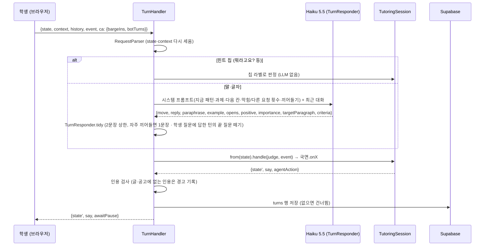

# 서강 글벗 v3 — 아키텍처

갱신 2026-11-16 · 대상 커밋: `main` · 대화 흐름 지도: `FLOW.md` · 설계 근거: `제안 - v3 새로 짜기 (ponytail).md` · `제안 - NCF 패턴으로 대화 설계.md` · `대본 목업 - NCF 패턴 1차.md`

---

## 1. 한눈에

서강 글벗은 대학생의 자기소개서를 **말로 대화하며** 함께 고치는 연구용 튜터다 (서강대학교 CAAI 연구실).
20분 세션: **첫 진단 → 과제 3개를 차례로 → 마무리 요약**. 학생은 튜터와 말로 이야기하고, 문단은 자기 손으로 고친다.

설계 원칙 세 가지:

1. **판단은 모델이 한 번에, 결정은 코드 한 곳에서.** 한 턴에 LLM은 1회(Haiku)만 부르고, 그 판정으로 상태를 옮기는 일은 `src/conversation/`의 `TutoringSession`(국면 클래스, State 패턴)이 한다. 받은 상태를 바꾸지 않고 새 상태를 돌려준다.
2. **대화는 NCF 패턴.** 상태를 옮기는 것은 기본 짝의 둘째 짝(학생의 답)뿐이고, 되묻기·확인·인정은 상태를 바꾸지 않는다 (Moore & Arar 2019).
3. **완료는 글이 실제로 나아졌을 때 — 체크리스트로.** 과제마다 "고친 문단에 보이나"로 판정할 수 있는 완료 항목 2–3개가 있다. 내용 과제의 항목은 결론 확인(A2.6)에서 학생과 합의한 내용으로 확정되고, 학생이 문단을 고치면 항목마다 절대 판정해 전부 충족일 때(또는 시범 문장을 받아들이면) 과제가 끝난다. 5축 루브릭은 글 전체의 잣대라 과제 판정에는 쓰지 않고, 세션 처음과 끝에 글 전체를 매기는 데만 쓴다 (2026-11-16).

```
┌──────────────────────── 브라우저 (React + Vite) ────────────────────────┐
│ Landing ─▶ Session ─────────────────────────────────▶ Summary           │
│            │  SessionController · voice/ (음성 인식·합성)                 │
│            │  상태(SessionState)를 들고 매 턴 서버에 보낸다                 │
└────────────┼────────────────────────────────────────────────────────────┘
             │ POST /api/diagnose · /api/turn · /api/evaluate · /api/summary
┌────────────▼──────────── Netlify Functions (상태 없음) ─────────────────┐
│ Handler: RequestParser → (LLM 1회) → TutoringSession → db → {ok,…}    │
└────────────┬───────────────────────────────┬────────────────────────────┘
             │ Anthropic Messages API         │ Supabase (선택)
             ▼                                ▼
   Sonnet 5.5: 진단·요약              sessions · turns
   Haiku 5.5: 턴·재평가
```

## 2. 세션 흐름

| 단계 | 누가 | 무엇을 | LLM |
|---|---|---|---|
| 시작 | 학생 | 자기소개서(필수) · 지원 공고(선택) · 이력 메모(선택) · 언어 | — |
| 첫 진단 | `/api/diagnose` | 채점 루브릭(부록 B 5축 × 하/중/상, v2와 같은 판정) + 잘한 점 + 과제 3개(가장 낮은 축부터, 각 완료 기준·첫 질문) + 브리핑 3파트 | Sonnet 1회 |
| 브리핑 | 코드 | 인사 → 브리핑 파트 1·2·3 (학생의 쉼이나 맞장구로 다음 파트) → 과제 1 시작 제안 | 0 |
| 과제 진행 | `/api/turn` | 학생 발화 판정 + 튜터의 다음 말 | Haiku 1회/턴 |
| 과제 수락 | 코드 | 진단이 만든 첫 질문(`opener`)을 바로 말함 | 0 |
| 문단 수정 | `/api/evaluate` | 완료 항목마다 고친 문단에 보이나 — 코드 항목(상투 표현)은 코드가, 나머지는 Haiku가 | Haiku 1회 (시범 문장 그대로·코드 항목만이면 0) |
| 마무리 | 코드 | 과제 표에서 만든 요약 파트 → 성공 확인 → 작별 | 0 |
| 요약 화면 | `/api/summary` | 튜터의 정리 + 다음에 할 것 · 끝 글을 처음과 같은 루브릭으로 재진단 | Sonnet 2회 (나란히) |

## 3. 한 턴의 흐름 (`/api/turn`)



- **서버는 상태를 들고 있지 않다.** 클라이언트가 매 턴 `SessionState`를 보내고, 서버는 `RequestParser.state`로 모양을 다시 세운 뒤에만 쓴다 (모르는 필드는 버림).
- **모델이 만든 말 vs 코드가 만든 말.** 브리핑·과제 시작 질문·시간 제안·마무리·수리 응답(반복/바꿔 말하기/예시)은 코드가 말한다 (`lines.ts`, `state.last`). 모델은 그 밖의 대화 문장만 만든다.

## 4. 상태 모델 (`src/state.ts`)

```
SessionState
├─ stage      opening → briefing → content / form → closing → ended
├─ open       지금 열린 첫째 짝 = NCF의 previous_node
│             { pattern: A3 | A5.0 | A5.1 | A5.5 | A2.6 | P1 | P1.4 | A4 | C4 …, firstPair, parts?, effect?, taskId?, criteria? }
│             P1.4 = 쓰는 법 보여 주기(뼈대) · A4 = 완료 직전 확인 질문 (코드만 연다)
│             criteria = A2.6을 열 때 모델이 함께 낸 완료 항목 후보 — 학생이 받으면 과제의 체크리스트가 된다
├─ topic      지금 다루는 키워드·문단 ("그건 어디 넣어요?"의 '그건')
├─ last       { played, paraphrase, example } — 수리 요청에 LLM 없이 답할 재료
├─ repaired   수리·학생 질문 직후인가 (이때의 "고마워요"는 곁가지만 닫는다, B4.4)
├─ unclearStreak  못 알아들은 횟수 (1: 다시 말해 줄래요? · 2: 예시와 함께 · 3: 다른 과제 제안)
├─ confusedStreak 학생이 연달아 "모르겠어요"(CONFUSED)라고 한 횟수 (1: 단서 · 2: 뼈대 · 3: 자리 불러 주기 · 4: 과제 미루고 다음) — 다른 수면 0, 수리는 건너뜀
├─ offGoalCount   학생이 지금 과제 밖의 것을 하자고 한 횟수 (세션 누적, 0: 겹쳐 받기 · 1+: 학생을 따른다)
├─ tasks[3]   { kind: content|form, axis, target, goal, doneWhen, criteria[], opener, status, evidence, fromExemplar,
│               startedAt, endedAt, turns, edits, experience[], nudged }
│             criteria = 완료 항목 { id, text, check: llm|noCliche, source: diagnosis|conclusion|code, met, needsNew? }
│             needsNew = 원래 문단에 없던 정보를 요구하는 항목 — 과제마다 최소 하나 (모델이 안 내면 코드가 n1을 넣는다)
│             doneWhen은 항목의 한 문장 요약(화면·프롬프트용), 판정은 criteria로
└─ startedAt · helped · closeOffered
```

과제 상태: `pending → active → done | skipped | timeout`. 시간 규칙: 과제 1에 집중(과제별 시간 제안 없음), 과제를 끝냈을 때 남은 시간이 7분 이상일 때만 다음 과제, 남은 3분이면 **제안 없이** 마무리 시작, 0분이면 요약 화면 (FLOW.md '시간 규칙').

첫 진단의 **평가**는 v2와 같은 채점 루브릭이다 (`src/rubric.ts`, 교수님 부록 B): 5축 `claim · hierarchy · alignment · cohesion · expression` 각각 `{grade: 하|중|상|판정불가, evidence}`, 정합성만 하위 둘 `transfer`(지원 업무와의 연결) · `consistency`(제공 자료와의 사실 일치)를 따로 내고 축 등급은 **판정할 수 있었던 하위 중 가장 나쁜 것**이다. 여기에 `strengths`(잘한 점) 한두 문장.
- 프롬프트(`src/prompts/diagnose.md`)의 루브릭 기술어·판정 규칙은 v2 `prompts.ts`를 글자 그대로 옮겼다 (위계와 예증은 `experience_flow` 꺼진 갈래 = v2 기본). 정합성 안내는 공고나 이력이 있으면/없으면 두 갈래 (`Diagnoser`).
- 파서는 진단을 실패시키지 않는다: 모양이 틀리거나 모르는 등급인 축은 그 축만 `판정불가`, 근거·잘한 점은 400자에서 자른다.
- 과제마다 모델이 `axis`를 적고, 코드가 v2 `decideTargetStage` 규칙으로 순서를 다시 세운다 — 하 → 중 → 상, 같은 등급이면 축 순서.
- 루브릭은 화면만 들고 있다 (응답 `{state, say, awaitPause, rubric, strengths}`). 턴마다 오가는 상태에는 넣지 않고, DB에는 `sessions.rubric`으로 남긴다.

## 5. 판정 라벨 (Haiku가 고른다 — NCF 1차 13개 + v2 caJudge에서 옮긴 2개 = 15개)

| 라벨 | 뜻 | 대화 흐름이 하는 일 (국면별 자세히: `FLOW.md`) |
|---|---|---|
| ANSWER · CONTINUER | 답 · 맞장구 | 열린 패턴의 다음 칸 · 브리핑 다음 파트 / 경험 이어 붙임 |
| ACCEPT · REJECT | 제안·결론 수락 · 거절·정정 | 과제 시작/결론 확인 · 다른 후보로 (재설득 없음) |
| EXEMPLAR_REQ | 써 달라 | 문장을 써 주지 않는다 — 쓰는 법을 보여 준다: 틀 + 다른 사람의 예 + 학생 재료의 자리 (P1.4 뼈대, 2026-11-16) |
| REPEAT_REQ · PARAPHRASE_REQ · EXAMPLE_REQ | 되묻기 | `last`에서 코드가 답 (상태 그대로) |
| USER_INQUIRY | 학생의 질문 | 답하고 원래 시퀀스 유지 |
| CLOSER | 인정·감사 | 시퀀스 닫기 (수리 직후면 곁가지만) |
| ABORT · PRE_CLOSING | 그만 · 끝내자 | 과제 skipped · 마무리(요약 먼저) |
| UNCLEAR | 못 알아들음 (튜터가 학생 말을 모름) | 단계적 되묻기 |
| CONFUSED | 학생이 모르겠다·생각이 안 난다 ("잘 모르겠어요", "이해가 안 돼요") | 막힘 사다리 (`ConfusionHandler`): 1회 단서+같은 질문 · 2회 뼈대(틀·다른 예·재료의 자리) · 3회 자리를 하나씩 불러 주기 · 4회 과제 미루고 다음 |
| OFF_GOAL | 지금 과제 말고 다른 것을 먼저 ("3문단 먼저 볼래요") — `importance`·`targetParagraph`를 함께 냄 | `OffGoalHandler`: 첫 요청 겹쳐 받기(lower면 양보+그러나+이유) · higher이거나 거듭 청하면 그 문단의 남은 과제로 바꿈 · 맞는 과제가 없으면 학생 요청에 답함 |

판정 정확도(지어낸 대본 29발화, 다음 행동 기준): 약 90% — `experiments/` 참고 (2026-11-03, 15라벨 두 번: 라벨 25–26/29 · 다음 행동 27/29 — 13라벨 때 같은 날 24/29 · 25/29).

### v2 caJudge → v3

v2(`pre-dashboard_code/`)의 CA 판정기는 층1 코드 판정 + 층2 배경 모델 호출 + 층3 행위 표(`CA_ACTION_TABLE`, 플래그 뒤)였다. v3는 **턴 호출 하나**(라벨·말·중요도를 함께)와 **코드의 결정**(`src/conversation/` 클래스)으로 같은 행을 옮겼다. 플래그·추가 호출 없음.

| v2 행 (caJudge.ts `CA_ACTION_TABLE`) | 근거 | v3 |
|---|---|---|
| `clue_up` · `exemplar` · `move_on` (notUnderstood streak 1/2/≥3, `dialogueState.ts`) | 이요안 10/09 "한 번 더 설명" · 허윤석·이요안 10/09 모범답안 1개 시범 · 사람 튜터 K20161108 t58 "보류하고 2번" | 라벨 `CONFUSED` + `confusedStreak` → `ConfusionHandler` (1·2회 모델 말, 3회 코드가 `skipped`('학생이 막힘') + `Agenda.proposeNext`) |
| `sequence_student_first` · `subsume` · `keep_goal` (student_agenda_importance) + `sessionGoal.ts` "한 번만 제안, 그래도 원하면 따른다" | 이요안 10/02 회의 · 10/09 2차 평가 · 사람 거절 30/73, K20161312 t19 "양보+그러나+이유" | 라벨 `OFF_GOAL` + `importance`·`targetParagraph` + `offGoalCount` → `OffGoalHandler` |
| `shorten` (interruption=high) | 이요안 10/02 "끼어드는 빈도로 판단" · 사람 튜터 코퍼스 겹쳐 시작 비율 p25 0.10 / p75 0.25, 표본 5턴 | 클라이언트 `TutorSpeaker.ca` → 요청 `ca` → `Interruption` (high면 프롬프트 안내 + 1문장 상한), `turns.judge.ca`에 기록 |

v2와 다른 점: 중요도를 한 턴 늦게(배경 호출) 받지 않고 같은 턴에 정한다 · 학생이 집은 '자리'는 과제 문단 번호로만 맞춘다 · 막힘 횟수는 새 과제를 시작하면 0 · 끼어들기가 잦아도 시범 턴은 2문장(받음 + 시범 문장)까지 둔다.

## 6. 과제 완료 판정 (`/api/evaluate`) — 체크리스트 (2026-11-16)

과제 완료는 **5축 루브릭이 아니라 과제별 완료 항목(criteria)** 으로 판정한다. 루브릭 기술어는 글 전체를 보는 말("첫 문단으로 본문을 예측할 수 있다")이라 문단 하나의 판정에 맞지 않았고, 예전의 "원래보다 더 충족하나"는 상대·이진 판정이라 조금만 고쳐도 통과했다.

```
첫 진단(Sonnet)   과제 단위는 문단(문장 하나를 과제로 잡지 않는다). 과제마다 criteria 초안 2–3개 {text, needsNew} + doneWhen 요약
                  needsNew = 원래 문단에 없던 정보를 요구하는 항목 — 최소 하나. 모델이 안 내면 코드가 n1("원래 없던 경험·사실이 들어간다")을 넣는다
                  form 과제의 문단에 상투 표현이 있으면 코드가 noCliche 항목을 더한다
결론 확인(A2.6)   내용 과제: 경험을 듣고 해석을 제시할 때 · 형식 과제: 무엇을 주장하고 무엇으로 받칠지 학생이 말한 뒤 —
                  모델이 criteria 후보를 낸다(judge.criteria) → 학생이 ACCEPT하면 합의한 항목이 진단 초안을 대신한다 (내용 과제의 합의 항목은 needsNew).
                  코드 항목은 남는다 (Tasks.confirmCriteria)
학생이 문단 저장 ─▶ 코드 항목 먼저: noCliche = findCliches(고친 문단) 비었나 (checks.codeCheck)
                   llm 항목이 있으면 Haiku 1회: 항목 id마다 {met, evidence 인용} — "고친 문단에 보이나" (절대 판정)
                   needsNew 항목은 인용이 비었거나 원래 문단에 이미 있는 글자면 '아직' (Evaluator.combine — 문장 바꿔 쓰기로는 통과 못 함)
                   연결(cohesion)·주장(claim) 축 과제면 지금 글 전체를 참고로 함께 준다 (판정 대상은 그 문단 하나)
                         ▼
          전부 met → 아직 done 아님. "항목은 다 들어갔어요." + 확인 질문 (A4.0, CheckPhase):
                     "지금 N문단이 하고 싶은 말이 뭐고, 어느 문장이 그걸 받쳐 주죠?"
                     학생이 맞게 짚으면(positive) done · 못 짚으면 힌트 하나(A4.1), 다시 고치기
          아니면  → active 유지, 항목 ✓/✗ 갱신(Tasks.applyVerdict), reason = 못 채운 항목 하나의 힌트 (A4.1, P1을 연다)
시범 문장 지름길(그대로 넣으면 done)은 없앴다 — 튜터는 문장을 써 주지 않는다 (교사 원칙, 2026-11-16)
```

- 모델이 빠뜨린 항목은 '아직'으로 본다. 코드 항목만 있는 과제는 모델을 부르지 않고 힌트도 코드가 쓴다 (`lines.codeHint`).
- 예전 상태(항목 없음)는 `doneWhen` 한 문장을 항목 하나로 본다 — 깨지지 않는다.
- 화면: 글 패널의 "완료 항목 n/m" 체크리스트, 과제 띠의 진행도, 요약 표의 항목 ✓/○.
- 5축 루브릭은 요약 화면에서만 다시 쓴다: `/api/summary`가 끝 글을 처음과 같은 `rubric.md`로 재진단해 처음/끝 카드를 나란히 보인다 (`Diagnoser.regrade`, `sessions.final_rubric`). 재진단이 실패해도 요약은 돌려준다.

## 7. LLM 호출 (`src/server/llm/LlmClient.ts`)

| 호출 | 모델 | 생각 깊이(effort) | 시간 제한 | 출력 |
|---|---|---|---|---|
| 진단 | `claude-sonnet-5-5` | medium | 22초 | 루브릭 5축 · 잘한 점 · 과제 3개 · 브리핑 |
| 턴 | `claude-haiku-5-5` | low | 12초 | 판정 + 튜터 말 |
| 재평가 | `claude-haiku-5-5` | low | 12초 | {items[{id, met, evidence}], reason} — 코드 항목만이면 호출 없음 |
| 요약 | `claude-sonnet-5-5` | medium | 22초 | {report, nextSteps} |
| 끝 재진단 | `claude-sonnet-5-5` | medium | 22초 | 루브릭 5축 · 잘한 점 (요약과 나란히 호출) |
| 튜터 목소리 | Google TTS `Chirp3-HD` (ko Autonoe · en Aoede) | — | 8초 | MP3 (`/api/tts`) |

- 모두 **구조화된 출력**(`output_config.format` json_schema)으로 받는다. Sonnet 5.5는 강제 `tool_choice`를 받지 않기 때문이다. 스키마는 보내기 전에 `additionalProperties:false`로 닫고 지원 안 되는 `minItems/maxItems`를 뺀다 — 개수는 출력 파서(`src/server/parse/outputs/`)가 응답 뒤에 맞춘다.
- 5.5 모델은 생각 토큰도 `max_tokens`에 들어가므로 출력 상한에 여유(6000)를 더한다. `temperature`는 보내지 않는다.
- 공고가 비어 있으면 프롬프트에 "공고 없음"을 명시해 모델이 공고 요구를 지어내지 않게 한다 (`postingText`).
- 모델 출력은 신뢰 경계다: 형식이 틀리면 사용자에게 "다시 보내 주세요 (이름 · 칸)"로 보이고, 서버 로그에 원인과 출력 앞부분이 남는다 (`LlmOutputParser`).

## 8. 화면 (`src/client/`)

화면 컴포넌트는 함수 컴포넌트로 그리기만 하고, 진행·음성은 클래스가 한다.

| 파일 | 역할 |
|---|---|
| `App.tsx` | 화면 셋을 상태 하나로 고른다 (라우터 없음) |
| `Landing.tsx` | 글·공고(선택)·이력(선택)·언어 입력, 문단 나눔 미리보기 → 진단 |
| `Session.tsx` | 세션 화면 조립 (그리기만) |
| `session/SessionController.ts` | 클래스 — 턴·재평가 호출, 대화 기록, 튜터 말 읽기, 쉼을 보낼 때 고르기 (`useSyncExternalStore`로 구독) |
| `session/useSession.ts` | 컨트롤러 · 음성 · 시계 · Space 키를 화면에 잇는 훅 |
| `ApiClient.ts` | 클래스 — `/api/*` 호출, 봉투 풀기, 사용자용 오류 문장 |
| `types.ts` | `Start` · `Line` · `StudentEvent` |
| `voice/TutorSpeaker.ts` | 클래스 — 튜터 말: `/api/tts`(Google TTS)를 `<audio>`로, 없으면 speechSynthesis. 줄 번호 · 안전 시간 |
| `voice/BargeInDetector.ts` | 클래스 — 튜터가 말하는 동안 메아리 제거 마이크 소리 크기로 끼어들기 감지 |
| `voice/SpeechListener.ts` | 클래스 — 브라우저 SpeechRecognition (켤 때마다 하나), 1.2초 침묵이면 한 턴, 끝난 직후 메아리 글자 겹침 거르기 |
| `voice/useVoice.ts` · `voice/types.ts` | 세 부품을 잇는 훅 — `Voice` 모양 (반이중: 튜터가 말하는 동안 인식 끔) |
| `Masthead.tsx` · `TaskStrip.tsx` · `Stamp.tsx` | 제호 띠(CAAI 표기·남은 시간) · 과제 3꼭지 · 도장 |
| `EssayPanel.tsx` · `AutoTextarea.tsx` | 글 전체를 문서로, 지금 문단은 늘 편집 가능, 다른 문단은 눌러서 고침 |
| `RubricCard.tsx` | 첫 진단 평가 카드 (v2 RubricPanel과 같은 내용) — 축 다섯 줄(쉬운 이름 + 등급), 누르면 질문·근거·설명(원래 기준 이름), 정합성은 하위 둘 따로. 세션에선 브리핑 동안 펼침·과제 시작 후 접힘, 요약에서 다시 |
| `VoicePanel.tsx` · `MicDesk.tsx` | 튜터의 지금 말(큰 자막) · 학생 실시간 자막 · 마이크 상태 · 말하기 힌트 · 글자 입력 보조 |
| `Summary.tsx` | 과제 표 · 튜터의 정리 · 처음 진단 · 처음 글/끝 글 |
| `styles.css` | 디자인 토큰(라이트/다크) — 규칙은 `DESIGN.md` |

음성 상태: `listening · speaking · thinking · muted · unsupported`. 학생 말이 끝나고 1.2초 조용하면 한 턴으로 보낸다. 문단을 고치는 동안은 듣기를 멈춘다.

## 9. 저장 (`supabase/schema.sql`, 선택)

- `sessions` — 언어·공고·처음 글·끝 글·과제 표(완료 항목 포함)·요약·성공 확인·첫 진단 루브릭(`rubric`)·끝 재진단(`final_rubric`, 실패하면 null).
- 이미 만든 DB에는 `supabase/migrations/`의 파일을 차례로 더한다 (`20261103010000_rubric.sql` · `20261116010000_final_rubric.sql`).
- `turns` — 턴마다 학생 말·튜터 말·`user_action`(판정 라벨)·`agent_action`(코드 행위)·`apr`(시퀀스 안의 자리)·판정 전체·지연.
  NCF 지표(시퀀스 완료율·상호작용 효율·확장 종류 분포)를 이 행들로 나중에 계산한다.
- 서버만 service_role 키로 쓴다. RLS를 켜고 정책을 두지 않아 브라우저에서는 읽기·쓰기 모두 막힌다. 환경 변수가 없으면 저장만 건너뛴다.

## 10. 폴더

```
sogang-tutor-v3/
├─ netlify/functions/   diagnose · turn · evaluate · summary · tts (입구, 각 8줄: 핸들러 만들고 handle(req))
├─ src/
│  ├─ state.ts          타입(readonly) · 상수 (20분 · 다음 과제 최소 7분 · 마무리 3분) — 클라이언트·서버 공용
│  ├─ rubric.ts         채점 루브릭 5축 · 등급 표시 말 · 가장 나쁜 하위 · 과제 순서 열쇠 — 클라이언트·서버 공용
│  ├─ lines.ts          코드가 말하는 문장 (ko/en)
│  ├─ checks.ts         문장 수 · 끝 질문 떼기 · 인용 검사 · 시간 · 상투 표현 사전
│  ├─ decide.ts         예전 입구 next() · wantsPause · editNeedsEval · newSession → TutoringSession
│  ├─ conversation/     대화 흐름 (State 패턴, 지도: FLOW.md)
│  │  ├─ TutoringSession.ts   입구 · 국면과 상관없는 수 · 국면 표
│  │  ├─ Phase.ts · PhaseFactory.ts   바탕 클래스(템플릿 메서드) · 상태 필드 → 국면
│  │  ├─ phases/        Briefing · TaskProposal · Experience · Conclusion · Editing · Idle · Closing · Ended
│  │  └─ RepairHandler.ts · ConfusionHandler.ts · OffGoalHandler.ts · Interruption.ts · Agenda.ts · Say.ts · Tasks.ts
│  ├─ server/           서버 전용
│  │  ├─ handlers/      DiagnoseHandler · TurnHandler · EvaluateHandler · SummaryHandler · TtsHandler
│  │  ├─ http/Handler.ts      바탕 클래스: 오류 → 봉투 {ok, data, error}
│  │  ├─ services/      TurnResponder(턴 + tidy) · Diagnoser · Evaluator · Summarizer · TtsService
│  │  ├─ llm/           LlmClient(구조화된 출력) · PromptBook(.md 읽기·채우기) · TurnPrompt
│  │  ├─ parse/         RequestParser(요청·상태) · LlmOutputParser + outputs/(스키마 + 파서) · fields(작은 검사, ValidationError)
│  │  ├─ store/SessionStore.ts   Supabase 저장 (없으면 건너뜀)
│  │  └─ deps.ts        부품 한 벌 조립
│  ├─ prompts/          tutor.ko/en · diagnose · evaluate · summary (.md)
│  └─ client/           화면 (8절)
├─ tests/               decide 표 테스트(대본 목업) · conversation(국면) · ca(막힘·다른 요청·끼어들기) · sessionController · checks · handlers · validate (node:test)
├─ experiments/         판정 정확도 · 판정+응답 · 골드 29발화 · 실제 API 연기 시험
├─ supabase/schema.sql · migrations/
├─ PRODUCT.md · DESIGN.md · ARCHITECTURE.md · FLOW.md
└─ 제안·대본 목업 문서 3개
```

## 11. 검증

```bash
npx tsc --noEmit                           # 타입
npm test                                   # 유닛 108개 (오프라인, LLM 0회)
npm run build                              # 프로덕션 빌드
npm run gold                               # 골드 29발화 실제 API (다음 행동 일치율)
npx tsx experiments/live_smoke.ts <.env>   # 네 함수를 실제 API로 한 번씩
npx netlify-cli dev                        # 로컬 http://localhost:8888
```

## 12. 알려진 한계 · 다음 단계

- **음성은 브라우저 내장 엔진.** Chrome 음성 인식은 구글 서버를 거친다. 연구실 lab-server로 바꿀 때 `src/client/voice/`만 교체한다.
- 메아리: 튜터가 말하는 동안은 인식을 끄고(반이중), 끼어들기는 Chrome 메아리 제거가 걸린 마이크 소리 크기로 잡는다. 끼어든 첫 음절 일부는 인식이 다시 켜지기 전이라 놓칠 수 있다. 서버 TTS가 없으면(브라우저 음성) 메아리 제거가 약해 끼어들기 문턱을 높인다.
- 판정 정확도는 지어낸 대본 기준이다. 사람 튜터 코퍼스의 실제 학생 발화로는 아직 재지 않았다.
- 재평가는 한 번 호출이다. 항목별 절대 판정으로 바꿔(2026-11-16) 순서 편향은 없어졌지만, 항목 문장이 모호하면 흔들릴 수 있다 — 흔들리는 항목은 대본 목업으로 문장을 다듬는다.
- 끝 재진단과 요약이 Sonnet 2회를 나란히 부른다 — Netlify 함수 시간 제한(26초) 안에 들어야 한다.
- Netlify 함수 시간 제한을 26초로 올려야 진단(Sonnet)이 안전하다.
- 1차 범위 밖 (NCF 문서 0절): 부분 반복·들음 확인·"잠깐만요"·퀴즈 흐름·화면 힌트 확장·영어 세션 실측.
