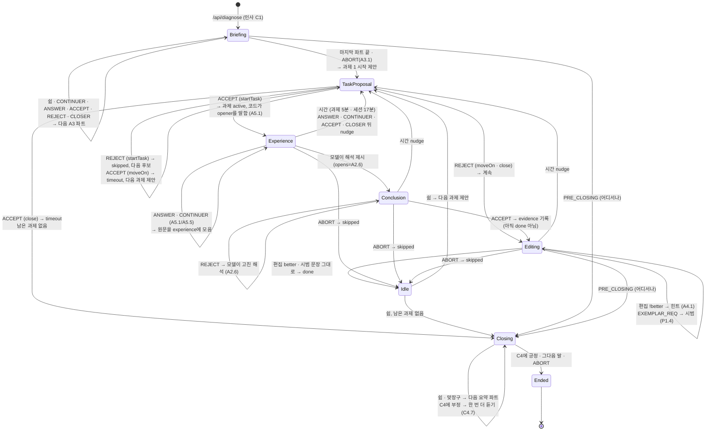

# 서강 글벗 v3 — 대화 흐름 (코드 지도)

갱신 2026-11-03 · 근거: `제안 - NCF 패턴으로 대화 설계.md` §2–§5 · `대본 목업 - NCF 패턴 1차.md` · 코드: `src/conversation/`

대화 흐름은 **State 패턴**이다. 세션(`TutoringSession`)이 지금 상태에서 **국면(Phase)** 하나를 고르고, 학생의 수(판정 라벨) 하나마다 그 국면의 메서드 하나를 부른다.
국면은 따로 저장하지 않는다 — 클라이언트와 서버가 주고받는 `SessionState`의 `stage · open.pattern · open.effect · 진행 중 과제`에서 매번 고른다 (`PhaseFactory.for`).

```
학생 발화 ─▶ TurnHandler ─▶ TurnResponder(Haiku: 판정 + 튜터 말) ─▶ TutoringSession.onSay
                                                                        ├─ 국면과 상관없는 수 먼저: 수리(B2) · UNCLEAR(B1) · PRE_CLOSING · ABORT
                                                                        └─ 나머지: PhaseFactory.for(state).onAnswer / onAccept / …
쉼        ─▶ TurnHandler ─▶ TutoringSession.onPause ─▶ 국면.onPause
문단 저장 ─▶ EvaluateHandler ─▶ (Evaluator: Haiku) ─▶ TutoringSession.onEdit ─▶ EditingPhase.onEdit
```

## 1. 국면과 이동

화살표 위 글자 = 학생의 수(판정 라벨) 또는 이벤트. **모델이 `opens`로 새 짝을 열면** 그 패턴의 국면으로 간다 (예: 과제 중에 모델이 A2.6을 열면 결론 확인).



**어느 국면에서든 상태를 옮기지 않는 수** (`RepairHandler`, 국면에 맡기지 않음):

| 수 | 하는 일 | agentAction |
|---|---|---|
| REPEAT_REQ | `last.played` 그대로 (코드) | B2.1 |
| PARAPHRASE_REQ | `last.paraphrase`, 없으면 기본 문장 | B2.4 |
| EXAMPLE_REQ | `last.example`, 없으면 기본 문장 | B2.6 |
| UNCLEAR ×1 / ×2 / ×3 | "한 번만 더" (코드) / 모델이 예시 붙여 다시 묻기 / 방향 바꾸기 P1 (코드) | B1.2.0 / B1.2.1 / B5.1 |
| CLOSER (수리·질문 직후) | 곁가지만 닫고 원래 짝 유지 (`Phase.onCloser` → `RepairHandler.closeSideSequence`) | B4.4 |

## 2. 국면별

말한 주체: **코드** = `lines.ts`·진단 결과·`state.last`를 코드가 말함 (LLM 0회) · **모델** = 이번 턴 Haiku의 `reply`.

### BriefingPhase — `src/conversation/phases/BriefingPhase.ts`
- **NCF**: C1 인사 + A3 Extended Telling (`open.pattern = A3`, 마무리 단계가 아닐 때)
- **튜터가 방금**: 인사 또는 진단 브리핑 파트 하나 (코드)
- **쉼을 기다림**: 예
- 쉼 · CONTINUER · ANSWER · ACCEPT · REJECT · CLOSER → `Agenda.nextPart` (마지막 파트 끝에 과제 1 시작 제안이 붙어 있다)
- USER_INQUIRY · EXEMPLAR_REQ → 기본값: 모델이 답하고 브리핑은 열린 채
- ABORT → A3.1: "네, 바로 시작할게요. ○○부터 볼까요?" (코드) → TaskProposal

### TaskProposalPhase — `phases/TaskProposalPhase.ts`
- **NCF**: 우리 패턴 P1 중 코드가 뜻을 정한 제안 (`open.effect` = startTask · moveOn · close)
- **튜터가 방금** (코드): 과제 시작 제안 · 과제 5분 초과 "다음으로 갈까요?" · 마감 3분 전 "정리할까요?"
- ACCEPT startTask → `Tasks.start` + "좋아요. {opener}" (코드, A5.1) → Experience
- ACCEPT moveOn → 과제 timeout → `Agenda.proposeNext` / ACCEPT close → 과제 timeout → `Agenda.startClosing`
- REJECT startTask → 그 과제 skipped (재설득 없음) → "네. 다음 과제는 …" / REJECT moveOn·close → 모델이 이어 감 (다시 묻지 않음: `nudged` · `closeOffered`)
- ABORT → 제안된 과제를 skipped (`Phase.onAbort` 기본값)

### ExperiencePhase — `phases/ExperiencePhase.ts`
- **NCF**: A5.1 Open Inquiry · A5.5 Extended Answer · A5.0 Closed Inquiry (상담형)
- **튜터가 방금**: 과제의 첫 질문 (코드, opener) · 경험 질문 / "네" 맞장구 / "또 있어요?" (모델)
- A5.1·A5.5에서 ANSWER · CONTINUER → 학생 말 원문을 `experience`에 붙이고 A5.5로 (모델이 다른 짝을 열면 그것). 그 뒤 시간 nudge
- A5.0의 ANSWER → 경험에 붙이지 않는다 (기본값)
- 형식(form) 과제도 opener가 A5.1로 열려 이 국면에서 시작한다 — 모델이 질문·힌트 패턴으로 넘어가면 Editing

### ConclusionPhase — `phases/ConclusionPhase.ts`
- **NCF**: Formulation + A2.6 Summary
- **튜터가 방금** (모델): "그러니까 ~한 경험이네요. 2문단에 넣는 거, 맞아요?"
- ACCEPT → 결론 문장을 `evidence`로 기록, 짝을 닫음 → Editing (아직 done 아님 — 글이 바뀌어야 한다)
- REJECT → 기본값: 모델이 고친 해석으로 다시 A2.6

### EditingPhase — `phases/EditingPhase.ts`
- **NCF**: A4.1 힌트 · P1 제안 · P1.4 시범 (과제 진행 중, 열린 짝이 없거나 P1·P1.4)
- **튜터가 방금** (모델): "고쳐 보세요" · 표현 과제의 질문·힌트 · 시범 한 문장 / (코드) 재평가 힌트
- 말에 대한 수는 모두 기본값 (`Phase`)
- **`onEdit`** (어느 국면에서 와도 이 규칙): 대상 밖 문단 → 무시 · 시범 문장 그대로 → done(fromExemplar), "네, 시범 문장이 들어갔어요." · better → done, "좋아졌어요. {reason}" · !better → active, reason이 힌트 (A4.1) · 재평가 없음 → 수정 횟수만

### IdlePhase — `phases/IdlePhase.ts`
- **NCF**: B4.0 닫힌 뒤 짧은 쉼 (과제 사이, 진행 중 과제 없음)
- **튜터가 방금**: 완료 피드백 · "여기까지 할게요" (코드)
- **쉼을 기다림**: 열린 짝이 없을 때만
- 쉼 → `Agenda.proposeNext` (남은 과제가 없으면 마무리)

### ClosingPhase — `phases/ClosingPhase.ts`
- **NCF**: C4.0 Last Topic(요약 A3) → C4.6 Success Check → C4.7 / 작별 (`stage = closing`)
- **튜터가 방금** (코드): "먼저, ○○ — 끝냈어요." … 마지막 파트 + "처음보다 나아진 것 같아요?" (C4)
- 요약 파트 중: 쉼 · 맞장구 · 답 · 수락 · 거절 · 인정 → 다음 파트 / 질문 · 써 달라 → 모델이 답하고 끝
- C4에 긍정 → `helped=true`, 모델 작별 → Ended / 부정 → `helped=false`, 한 번 더 듣기 → 다음 말에 Ended
- ABORT → "네, 수고 많았어요." (코드) → Ended

### EndedPhase — `phases/EndedPhase.ts`
- 어떤 수·쉼·편집에도 움직이지 않는다. 클라이언트는 요약 화면으로 간다.

### 함께 쓰는 부품
| 파일 | 하는 일 |
|---|---|
| `TutoringSession.ts` | 입구: `from(state)` · `start(seed)` · `onSay` · `onPause` · `onEdit` · `handle` · `wantsPause` · `editNeedsEval` · `toState` |
| `Phase.ts` | 바탕 클래스 — 템플릿 메서드와 기본값 (과제 중 일반 규칙) |
| `PhaseFactory.ts` | 상태 필드 → 국면 (위에서부터 처음 맞는 줄) |
| `RepairHandler.ts` | B2 수리 · B1 UNCLEAR · B4.4 |
| `Agenda.ts` | 다음 파트 · 다음 과제 제안 · 마무리 시작 · 시간 nudge |
| `Say.ts` | 결과 만들기: `nothing` · `line` · `code`(last 갱신) · `model`(opens 반영) · `end` |
| `Tasks.ts` | 과제 표 연산 (update · start · finish · skip · countTurn · exemplarUsed) |
| `src/decide.ts` | 예전 입구 `next()` · `wantsPause` · `editNeedsEval` · `newSession` — `TutoringSession`에 위임 |

## 3. 따라가 보기 — 목업 M1→M4

자료는 `tests/fixture.ts` (= 목업 공통 자료). `decide.test.ts`의 `BRIEFED` · `M4-22` 행이 같은 길을 검사한다.

| 목업 | 학생 / 이벤트 | 들어가는 곳 | 국면 → 메서드 | 결과 |
|---|---|---|---|---|
| M1-1 | 시작하기 | `DiagnoseHandler.run` → `Diagnoser.diagnose`(Sonnet) | `TutoringSession.start` | `stage=opening`, `open=A3 part 0`, 인사 (코드) → **Briefing** |
| M1-2 | "네." CONTINUER | `TurnHandler` → `TurnResponder.respond`(Haiku) → `onSay` | Briefing`.onContinuer` → `Agenda.nextPart` | 파트 1 (코드), `stage=briefing` |
| M1-3 | (1.0초 쉼) | `SessionController.pauseDelay` → `send({kind:'pause'})` → `onPause` | Briefing`.onPause` → `nextPart` | 파트 2 |
| M1-5 | "음." CONTINUER | `onSay` | Briefing`.onContinuer` → `nextPart` → `servePart`(마지막) | 파트 3 + "○○부터 볼까요?", `open=P1 startTask t1` → **TaskProposal** |
| M1-7 | "네 좋아요." ACCEPT | `onSay` | TaskProposal`.onAccept` → `Tasks.start` | t1 active, `stage=content`, "좋아요. {opener}" (코드), `open=A5.1` → **Experience** |
| M2-9·11·13 | 경험 이야기 ANSWER | `onSay` (`countTurn`: t1.turns+1) | Experience`.onAnswer` → `collect` → `Agenda.nudge` | `experience`에 원문 3개, `open=A5.5`; 13번에 모델이 "또 있어요?"(A5.0) |
| M2-15 | "아니요 그거요." ANSWER | `onSay` | Experience(A5.0)`.onAnswer` → 기본값 | 경험에 붙이지 않음; 모델이 해석 제시 (opens=A2.6) → **Conclusion** |
| M3-17 | "네 맞아요." ACCEPT | `onSay` | Conclusion`.onAccept` | `t1.evidence` = 결론 문장, `open=null` ("좋아요, 고쳐 보세요" 모델) → **Editing** |
| M4-19 | [편집] 2문단 | `EvaluateHandler` → `editNeedsEval` 참 → `Evaluator.evaluate`(Haiku) → `onEdit` | `EditingPhase.onEdit` (better=false) | t1 active, `edits=1`, reason을 힌트로 (코드, A4.1, `open=P1`) |
| M4-21 | "아 네." ACCEPT | `onSay` | Editing`.onAccept` → 기본값 | 모델 짧은 답, `open=null` |
| M4-22 | [편집] 2문단 | `EvaluateHandler` → `onEdit` | `EditingPhase.onEdit` (better=true) | t1 done, `edits=2`, "좋아졌어요. {reason}" (코드) → **Idle** (쉼 기다림) |
| M4-24 | (쉼) | `onPause` | Idle`.onPause` → `Agenda.proposeNext` | "다음 과제는 …, 시작해 볼까요?" `open=P1 startTask t2` → **TaskProposal** |
